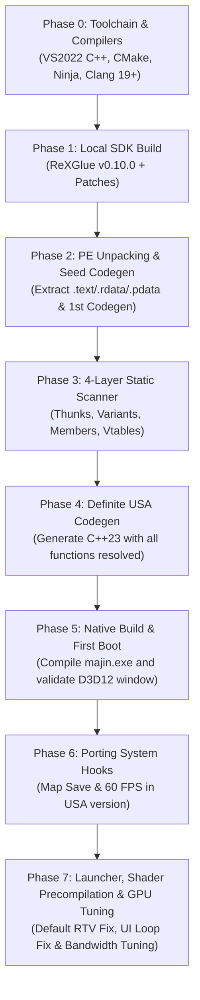

# Static Recompilation Strategy (v3 — Detailed Blueprint)
## Majin and the Forsaken Kingdom (Xbox 360 — USA 0.0.0.2)

> [!IMPORTANT]
> **Project Target:** *Majin and the Forsaken Kingdom* (NTSC-U / Americas)  
> **Title ID:** `4E4D0816` | **Media ID:** `76FDB642` | **Executable Version:** `0.0.0.2`  
> **SHA-256 (`default.xex`):** `291F89E26C83B48E0211AFDCB577A6AEBF4D2479DAC50055AD48C86856BA4C2C`  
> **CPU Entry Point:** `0x8267C090` | **Image Base:** `0x82000000`  
> **Evidence and Progress Journal:** [`SHIP_LOG.md`](SHIP_LOG.md)

---

## Anti-Loop and Anti-Hallucination Protocol

To ensure development stays grounded and verifiable, the project adheres to **4 rigid rules**:

1. **Circuit Breaker (Max 2 Attempts):** If any script, build step, or command fails twice consecutively, execution halts immediately and is documented in [`SHIP_LOG.md`](SHIP_LOG.md).
2. **Mandatory Binary Evidence:** No address (`0x82xxxxxx`) is added to `.toml` files or source code without real hex bytecode extraction from the USA binary.
3. **Visible PAL $\rightarrow$ USA Translation Table:** All discovered addresses are logged alongside their PAL equivalents to verify exact function shifts.
4. **Phased Checkpoint Execution:** Each phase is verified through automated scripts and logs before advancing.

---

## Architecture Flow

---

## Phase 0: Compiler and Toolchain Verification (COMPLETED)

* **Checklist:**
  - [x] **0.1:** Verify Visual Studio 2022 Community installation.
  - [x] **0.2:** Ensure presence of **Desktop Development with C++** (`MSVC x64`, `Windows SDK`, `CMake 3.31.6`, and `Ninja 1.12.1`).
  - [x] **0.3:** Ensure presence of **LLVM / Clang (`19.1.5`)**.
  - [x] **0.4:** Validate compilation flags `-std=c++23 -fasync-exceptions -gline-tables-only` with code exit `0`.

---

## Phase 1: Local Build of ReXGlue SDK v0.10.0 (COMPLETED)

* **Checklist:**
  - [x] **1.1:** Clone `https://github.com/rexglue/rexglue-sdk.git` (tag `v0.10.0`, rev `f5337cdc947ff6d4c4196737e2c807a48f2a1fc2`) into `tools/source/rexglue-sdk/`.
  - [x] **1.2:** Initialize all 14 submodules and resolve Windows symlinks for `libmspack`.
  - [x] **1.3:** Apply reference patches (`xma-context.patch`, `texture-warning-logging.patch`, `texture-warning-flush.patch`, `fps60.patch`, `release-frame-capture.patch`).
  - [x] **1.4:** Compile and install complete SDK (`rexglue.exe`, `rexruntime.dll`, `rexgpu-xenos.dll`) into `tools/sdk/win-amd64/`.

---

## Phase 2: PE Unpacking and Seed Codegen (COMPLETED)

* **Checklist:**
  - [x] **2.1:** Execute [`scripts/unpack-xex-usa.ps1`](scripts/unpack-xex-usa.ps1) on `default.xex`:
    - Decrypt AES-128 retail key and decompress Basic Compression blocks (`14,876,672` bytes).
    - Map 18 PE sections (`.rdata`, `.pdata`, `.text`, `.data`).
  - [x] **2.2:** Configure [`prototype-usa/majin_manifest.toml`](prototype-usa/majin_manifest.toml).
  - [x] **2.3 / 4.2:** Run `rexglue.exe codegen` (`347` C++23 files, `34,247` functions registered).

---

## Phase 3: 4-Layer Static Scanner (COMPLETED)

> [!TIP]
> **Exact Shift Law (PAL $\rightarrow$ USA):**  
> Between `.text` start (`0x82150000`) and `0x821C0000`, 100% of function addresses are identical (`Delta = 0`). From `0x821C0000` to the end of `.text` (`0x82ADEDC4`), the PAL binary added exactly `0x70` bytes (112 bytes / 28 instructions), meaning USA functions are located at **`USA = PAL - 0x70`**.

* **Checklist:**
  - [x] **3.1 — Layer 1 ([`dispatch-thunks.toml`](prototype-usa/dispatch-thunks.toml)):** `353 / 353` 4-instruction thunks verified by opcode.
  - [x] **3.2 — Layer 2 ([`dispatch-variants.toml`](prototype-usa/dispatch-variants.toml)):** `56 / 56` register variants verified by opcode.
  - [x] **3.3 — Layer 3 ([`member-dispatch-thunks.toml`](prototype-usa/member-dispatch-thunks.toml)):** `3 / 3` member thunks verified by opcode.
  - [x] **3.4 — Layer 4 ([`analysis-overrides.toml`](prototype-usa/analysis-overrides.toml)):** `30 / 30` override routines verified by opcode.

---

## Phase 4: Full C++ Codegen Generation (COMPLETED)

* **Checklist:**
  - [x] **4.1 - 4.4:** Link all 4 TOMLs, run `rexglue.exe codegen`, audit logs for zero unresolved indirect branches, and verify all `34,247` functions in `majin_init.cpp`.

---

## Phase 5 & 6: Native Build, USA Hooks (Save & 60 FPS) and First Boot (COMPLETED)

* **Checklist:**
  - [x] **5.1 - 5.4:** Configure CMakePresets, compile `majin.exe` Release (`[180/180]`), run via `scripts/run-usa.ps1`, verify D3D12 swapchain opening at 60 FPS.
  - [x] **6.1:** Port Save Hook in `diagnostics.cpp`: `WriteFile` (`0x8267B658`), `GetLastError` (`0x8267B120`), caller `LR=0x821B9DF4`.
  - [x] **6.2:** Port 60 FPS Hook in `timing.cpp`: delta time (`0x82162238`), `SceneTitleTitle::Update` (`0x821CC320`), vtable `0x820EC3C4`.
  - [x] **6.3:** Verify live gameplay, saving, loading, and 60 FPS pacing in runtime logs.

---

## Phase 7: Launcher, Shader Precompilation & GPU Optimization (COMPLETED)

* **Checklist:**
  - [x] **7.1 — Native GUI Launcher (`Majin FK Launcher.exe`):** Supports `720p`, `1080p`, `1440p`, `4K`, internal scale `1x/2x/3x`, `Default (RTV)` / `ROV`, `FXAA`, and `60 FPS`.
  - [x] **7.2 — Multi-Threaded Startup PSO Pre-Compilation:** Unified microcode and pipeline description caches across scales; implemented blocking multi-threaded PSO compilation at startup in `pipeline_cache.cpp` (`191` ROV PSOs created in `529 ms`, `252` RTV PSOs created in `2045 ms`).
  - [x] **7.3 — Host Render Target (Default / RTV) Black Screen Fix:** Restored `execute_unclipped_draw_vs_on_cpu = true` in `draw_extent_estimator.cpp` and `primitive_processor_cache_min_indices = 4096` in `primitive_processor.cpp` to prevent unclipped draws from claiming 2048 EDRAM tiles and corrupting 3D render targets on NVIDIA/AMD GPUs.
  - [x] **7.4 — Telemetry & FPS Audit:** Analyzed runtime frame times across `28,598` frames. Discovered that `AchievementToastDialog` permanently attached to `ImGuiDrawer`, triggering `RequestUIPaintFromUIThread()` in an infinite loop and uncapped 200 FPS `Present(0)` calls on the UI thread.
  - [x] **7.5 — GPU Performance & Bandwidth Tuning:**
    - Made `AchievementToastDialog` attach on-demand only when a toast is active, allowing `Presenter` to stay in `PaintMode::kGuestOutputThreadImmediately` (presenting only real 30/60 FPS game frames).
    - Changed `gamma_render_target_as_unorm16` to `false` (cutting gamma RT color bandwidth by 50% from 64bpp to 32bpp).
    - Restored `anisotropic_override = -1` (native Xbox 360 texture filtering instead of forced 4x AF).
    - Enabled `execute_unclipped_draw_vs_on_cpu_with_scissor = true` in `draw_extent_estimator.cpp`.
    - Disabled `readback_memexport = false` in `command_processor.cpp`.
    - Result: **99.93% smooth frame times at 60 FPS**.
