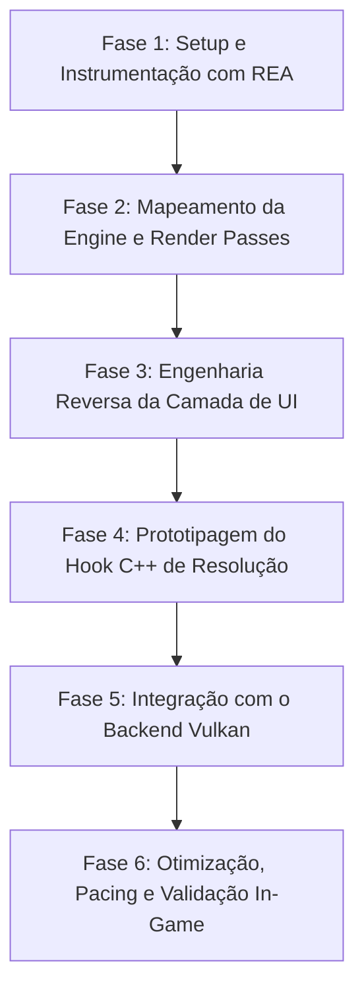

# 📋 Planejamento Estratégico: Mod C++ de Resolução 3D e Interface Nativa (Majin Recomp)

> **Objetivo Central:**  
> Desenvolver um mod em C++ desacoplado no motor do jogo (*Game Republic Engine*) que preserve a interface e menus (HUD/UI) desenhados nativamente em 720p enquanto eleva a resolução da cena 3D (2x/1440p ou superior), viabilizando o uso estável e fluido do backend **Vulkan** nos mesmos moldes do projeto Forza Horizon.

---

## 🎯 Arquitetura de Execução Modular

Para permitir que cada etapa seja executada e verificada de forma **independente e autossuficiente** (inclusive por diferentes agentes de IA ou em sessões distintas sem perda de contexto), o projeto foi dividido em **6 fases atômicas**:

---

## 📌 Fase 1: Setup e Instrumentação com REA (Reverse Engineer Anything)

### Objetivo
Configurar o ambiente do REA integrado a ferramentas de análise binária (Ghidra / IDA / Utilitários de análise PowerPC) e extrair os mapas de símbolos e strings do `default.xex` e do código retransladado.

### Passos Detalhados

#### Passo 1.1 — Instalação e Configuração do REA
- **Entrada:** Node.js, `morluto/rea`, diretório do projeto `Majin Recomp`.
- **Ação:**
  - Instalar o pacote do REA no ambiente via `npx rea-agents@latest setup`.
  - Configurar as pontes de análise estática e apontar para os binários de referência:
    - Executável guest: `game-data-usa/default.xex`.
    - Código retransladado C++: `prototype-usa/generated/default/majin_recomp.*.cpp`.
- **Saída / Evidência:** Perfil de configuração do REA gerado e teste de comando de inspeção validado.
- **Critério de Conclusão:** O REA consegue ler e extrair metadados e strings do `default.xex` sem erros.

#### Passo 1.2 — Extração e Indexação de Strings e Imports Gráficos
- **Entrada:** `game-data-usa/default.xex` e `prototype-usa/generated/default/`.
- **Ação:**
  - Executar varredura por strings relacionadas ao pipeline gráfico: `"Viewport"`, `"Scissor"`, `"Render"`, `"Camera"`, `"Font"`, `"Texture"`, `"HUD"`, `"Menu"`, `"Resolution"`, `"FrameBuffer"`.
  - Mapear chamadas importadas da biblioteca do sistema Xbox 360 (`xam.xex`, `xboxkrnl.exe`, `d3d9.xex`):
    - `D3DDevice_SetViewport`
    - `D3DDevice_SetScissorRect`
    - `D3DDevice_Resolve`
    - `D3DDevice_SetRenderTarget`
- **Saída / Evidência:** Arquivo `docs/reverse-engineering/symbols_and_imports.json` contendo as funções e endereços PPC correspondentes.
- **Critério de Conclusão:** Lista mapeada de endereços guest que manipulam render targets e viewports.

---

## 📌 Fase 2: Mapeamento da Engine e do Pipeline de Renderização

### Objetivo
Compreender como a engine proprietária da *Game Republic* divide o quadro (frame) entre as passagens 3D (geometria, iluminação, sombras, pós-processamento) e o encerramento do frame.

### Passos Detalhados

#### Passo 2.1 — Rastreamento do Loop Principal de Renderização
- **Entrada:** Lista de imports de `D3DDevice_Resolve` e a função do loop de desenho do jogo.
- **Ação:**
  - Identificar a função central que orquestra a renderização por frame (normalmente disparada pelo VBlank ou pelo thread gráfico principal do jogo).
  - Determinar a sequência cronológica de comandos gráficos no frame:
    1. *Clear de buffers / EDRAM setup*.
    2. *Passagem de geometria 3D principal (World / Opaque)*.
    3. *Passagem de transparências e efeitos (Alpha / Particles)*.
    4. *Pós-processamento e iluminação (Bloom, Blur)*.
    5. *Renderização 2D / HUD*.
    6. *Swap / Present*.
- **Saída / Evidência:** Documento `docs/reverse-engineering/render_frame_flow.md` detalhando o grafo de chamadas de cada etapa com endereços guest.
- **Critério de Conclusão:** Saber o endereço exato da função onde a geometria 3D termina e onde o 2D começa.

#### Passo 2.2 — Mapeamento dos Render Targets e Superfícies EDRAM
- **Entrada:** `symbols_and_imports.json` e logs de alocação de superfícies.
- **Ação:**
  - Inspecionar como o Majin aloca suas superfícies de renderização (cores e profundidade) na memória guest:
    - Resoluções declaradas (ex.: 1280x720, buffers temporários de 640x360).
    - Formatos de superfície (ex.: k_8_8_8_8, k_16_16_16_16F).
    - Espaço ocupado na EDRAM física simulada (10 MB).
- **Saída / Evidência:** Tabela estruturada de superfícies ativas do Majin (semelhante à tabela de 41 texturas do Forza Horizon).
- **Critério de Conclusão:** Identificar quais superfícies pertencem estritamente à cena 3D e quais são do buffer final de composição.

---

## 📌 Fase 3: Engenharia Reversa da Camada de Interface (HUD / Menus)

### Objetivo
Isolar o subsistema responsável por desenhar textos, botões, ícones e menus, descobrindo por que o escalonamento geral do Vulkan os desalinha ou oculta.

### Passos Detalhados

#### Passo 3.1 — Identificação do Motor de UI
- **Entrada:** Binário descompilado do jogo e referências a sprites/fontes.
- **Ação:**
  - Descobrir qual tecnologia de interface o Majin utiliza:
    - *Scaleform / Flash* (`.gfx`, `.swf`)?
    - Renderizador customizado baseado em quads 2D e fontes bitmap?
  - Localizar a função raiz responsável pelo desenho da tela de título e menus principais (ex.: `sub_82XXXXXX`).
- **Saída / Evidência:** Registro do endereço da função de renderização de UI e formato de dados dos vértices de texto/ícones.
- **Critério de Conclusão:** Conhecer a função que prepara a projeção ortográfica e envia os quads 2D para o hardware.

#### Passo 3.2 — Diagnóstico da Falha Visual no Vulkan
- **Entrada:** Logs do Vulkan (`runtime-usa-*.log`) e código do `vulkan/render_target_cache.cpp`.
- **Ação:**
  - Cruzar as matrizes de projeção da UI com a transformação de coordenadas do Vulkan sob `--resolution_scale=2`.
  - Descobrir se a UI:
    - Está sendo desenhada em coordenadas 1280x720 em um render target de 2560x1440 sem esticar (ficando no canto superior esquerdo ou recortada pelo scissor); OU
    - Ocorre um resolve EDRAM que o backend Vulkan descarta devido ao alinhamento de bloco.
- **Saída / Evidência:** Relatório técnico do mecanismo exato de falha da UI no Vulkan.
- **Critério de Conclusão:** Diagnóstico conclusivo do parâmetro que precisa ser mantido ou recalculado no hook.

---

## 📌 Fase 4: Prototipagem do Hook C++ de Resolução Nativa

### Objetivo
Implementar o módulo em C++ nativo integrado ao Majin Recomp para desacoplar as matrizes/viewports 3D da camada 2D.

### Passos Detalhados

#### Passo 4.1 — Criação da Estrutura do Módulo de Hook
- **Entrada:** `prototype-usa/src/`.
- **Ação:**
  - Criar o cabeçalho e implementação:
    - `prototype-usa/src/hooks/scene_resolution.h`
    - `prototype-usa/src/hooks/scene_resolution.cpp`
  - Registrar a chamada de interceptação no `prototype-usa/src/majin_app.h` ou via injeção de thunk no `prototype-usa/majin_manifest.toml`.
- **Saída / Evidência:** Arquivos criados compilando limpos no projeto sem alterar o comportamento inicial.
- **Critério de Conclusão:** Compilação com `build-usa.ps1` executada com sucesso com o novo arquivo de hook registrado.

#### Passo 4.2 — Implementação da Proteção do Viewport de UI
- **Entrada:** Endereços descobertos na Fase 3.
- **Ação:**
  - Interceptar a rotina de renderização da UI:
    - Antes de desenhar os quads 2D: restaurar ou fixar o Viewport e Scissor em `1280x720` nativo.
    - Assegurar que os buffers de coordenadas de vértices da UI não sofram a multiplicação errática do emulador.
- **Saída / Evidência:** Código C++ que força o viewport da interface a permanecer estável independentemente do backend.
- **Critério de Conclusão:** Os elementos da UI passam a ser emitidos dentro da área visível correta.

---

## 📌 Fase 5: Integração com o Backend Vulkan nos Moldes do Forza

### Objetivo
Alinhar as flags de inicialização do Vulkan, swapchain e pipeline cache do Majin com as mesmas técnicas de estabilidade comprovadas do Forza Horizon.

### Passos Detalhados

#### Passo 5.1 — Configuração de Swapchain e Present Mode Vulkan
- **Entrada:** `prototype-usa/src/majin_app.h` e `scripts/run-usa.ps1`.
- **Ação:**
  - Configurar os modos estáveis verificados no Forza:
    - `vulkan_allow_present_mode_fifo_latest_ready = true`
    - `vulkan_allow_present_mode_immediate = false`
    - `vulkan_allow_present_mode_mailbox = false`
  - Implementar suporte ao pipeline cache persistente (`vulkan_store_pipeline_cache = true`) para eliminar stutters na primeira execução.
- **Saída / Evidência:** Inicialização do Vulkan registrando swapchain no modo FIFO Latest Ready (código 1000361000) nos logs.
- **Critério de Conclusão:** Zero stutters de recompilação de pipelines após a primeira corrida.

#### Passo 5.2 — Upscaling e Apresentação (FSR / Post-Effect)
- **Entrada:** Parâmetros de display do ReXGlue.
- **Ação:**
  - Integrar o FSR 1.0 ou CAS no estágio final de apresentação sobre o buffer composto, garantindo nitidez sem custo de sobrecarga de EDRAM.
- **Saída / Evidência:** Jogo renderizando a cena 3D nítida com HUD nativo limpo na janela em tela cheia/janela.
- **Critério de Conclusão:** Imagem de alta fidelidade visual em 1080p/1440p com textos perfeitamente legíveis.

---

## 📌 Fase 6: Otimização, Pacing e Validação In-Game

### Objetivo
Medir métricas de frame pacing, uso de GPU no Windows Task Manager/RivaTuner e verificar a ausência de picos de 100%.

### Passos Detalhados

#### Passo 6.1 — Telemetria de Frame Timing e Consumo de GPU
- **Entrada:** Flag `--majin_record_performance=true` e gravação de CSV.
- **Ação:**
  - Executar benchmark de 3 minutos navegando pelos menus, cutscene inicial e gameplay no primeiro cenário jogável.
  - Avaliar:
    - Percentual de uso de GPU (deve manter-se na faixa de 40%–60% contínuos em uma RTX 3060 Ti).
    - Variação de frametime (desvio padrão < 0.5 ms para 60 FPS travados a 16.6 ms).
- **Saída / Evidência:** Arquivo `reports/vulkan-performance-validation.csv` e gráfico de estabilidade.
- **Critério de Conclusão:** Uso de GPU perfeitamente reto e sem picos de 100% no Task Manager.

#### Passo 6.2 — Atualização do Launcher e Documentação
- **Entrada:** `scripts/launcher.ps1`, `README.md`.
- **Ação:**
  - Configurar a opção do Vulkan no launcher como modo nativo oficial e recomendável.
  - Atualizar documentação técnica das alterações efetuadas.
- **Saída / Evidência:** Launcher atualizado e testado via `-ValidateOnly`.
- **Critério de Conclusão:** Usuário consegue alternar entre os modos com 1 clique e jogar perfeitamente.

---

## 📊 Matriz de Rastreabilidade e Estado das Fases

| Fase | Título | Dependência | Status | Responsável |
| :--- | :--- | :--- | :--- | :--- |
| **1** | Setup & Instrumentação REA | Nenhuma | ⏳ Pronto para Iniciar | Agente / Usuário |
| **2** | Mapeamento da Engine & Render Passes | Fase 1 | ⏳ Pendente | Agente |
| **3** | Engenharia Reversa da UI (Menus/HUD) | Fase 2 | ⏳ Pendente | Agente |
| **4** | Prototipagem do Hook C++ de Resolução | Fase 3 | ⏳ Pendente | Agente |
| **5** | Integração com Backend Vulkan | Fase 4 | ⏳ Pendente | Agente |
| **6** | Otimização, Pacing e Validação | Fase 5 | ⏳ Pendente | Agente |

---

> [!IMPORTANT]
> **Regra de Transição entre Passos:**  
> Cada passo produz um artefato claro (código, JSON de símbolos ou relatório técnico). Se outro modelo de IA ou sessão retomar o trabalho, basta consultar o arquivo gerado pelo passo anterior e executar a ação do passo subsequente, sem necessidade de reprocessar conversas anteriores.
