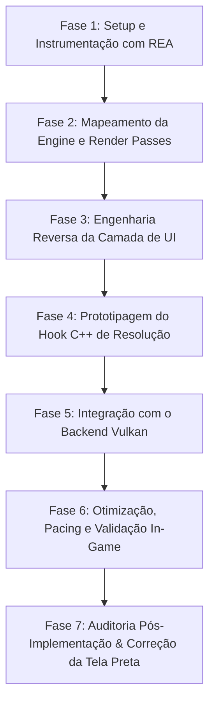

# 📋 Planejamento Estratégico: Mod C++ de Resolução 3D e Interface Nativa (Majin Recomp)

> [!WARNING]
> **Status Atual da Implementação (06/11/2026): FALHA PERSISTE / INVESTIGAÇÃO EM ABERTO.**  
> Apesar das correções realizadas no hook C++ (`scene_resolution.cpp`), na inicialização do aplicativo (`majin_app.h`), nos scripts de execução (`run-usa.ps1`) e na biblioteca do backend (`rexgpu-xenos.dll`), o backend **Vulkan continua sem renderizar a imagem dos menus** (permanecem em tela preta) e, ao entrar in-game, **apenas alguns poucos objetos 3D são renderizados**. A modificação para resolução nativa com Vulkan **não funcionou** e necessita de nova bateria de investigação aprofundada.

> **Objetivo Central:**  
> Desenvolver um mod em C++ desacoplado no motor do jogo (*Game Republic Engine*) que preserve a interface e menus (HUD/UI) desenhados nativamente em 720p enquanto eleva a resolução da cena 3D (2x/1440p ou superior), viabilizando o uso estável e fluido do backend **Vulkan** nos mesmos moldes do projeto Forza Horizon.

---

## 🎯 Arquitetura de Execução Modular

Para permitir que cada etapa seja executada e verificada de forma **independente e autossuficiente** (inclusive por diferentes agentes de IA ou em sessões distintas sem perda de contexto), o projeto foi dividido em fases atômicas:

---

## 📌 Fase 1: Setup e Instrumentação com REA (Reverse Engineer Anything)

### Objetivo
Configurar o ambiente do REA integrado a ferramentas de análise binária (Ghidra / IDA / Utilitários de análise PowerPC) e extrair os mapas de símbolos e strings do `default.xex` e do código retransladado.

### Passos Detalhados

#### Passo 1.1 — Instalação e Configuração do REA
- **Entrada:** Node.js, `morluto/rea`, diretório do projeto `Majin Recomp`.
- **Ação:**
  - Instalar o pacote do REA no ambiente via `npx rea-agents@latest setup`.
  - Configurar as pontes de análise estática e apontar para os binários de referência:
    - Executável guest: `game-data-usa/default.xex`.
    - Código retransladado C++: `prototype-usa/generated/default/majin_recomp.*.cpp`.
- **Saída / Evidência:** Perfil de configuração do REA gerado e teste de comando de inspeção validado.
- **Critério de Conclusão:** O REA consegue ler e extrair metadados e strings do `default.xex` sem erros.

#### Passo 1.2 — Extração e Indexação de Strings e Imports Gráficos
- **Entrada:** `game-data-usa/default.xex` e `prototype-usa/generated/default/`.
- **Ação:**
  - Executar varredura por strings relacionadas ao pipeline gráfico: `"Viewport"`, `"Scissor"`, `"Render"`, `"Camera"`, `"Font"`, `"Texture"`, `"HUD"`, `"Menu"`, `"Resolution"`, `"FrameBuffer"`.
  - Mapear chamadas importadas da biblioteca do sistema Xbox 360 (`xam.xex`, `xboxkrnl.exe`, `d3d9.xex`):
    - `D3DDevice_SetViewport`
    - `D3DDevice_SetScissorRect`
    - `D3DDevice_Resolve`
    - `D3DDevice_SetRenderTarget`
- **Saída / Evidência:** Arquivo `docs/reverse-engineering/symbols_and_imports.json` contendo as funções e endereços PPC correspondentes.
- **Critério de Conclusão:** Lista mapeada de endereços guest que manipulam render targets e viewports.

---

## 📌 Fase 2: Mapeamento da Engine e do Pipeline de Renderização

### Objetivo
Compreender como a engine proprietária da *Game Republic* divide o quadro (frame) entre as passagens 3D (geometria, iluminação, sombras, pós-processamento) e o encerramento do frame.

### Passos Detalhados

#### Passo 2.1 — Rastreamento do Loop Principal de Renderização
- **Entrada:** Lista de imports de `D3DDevice_Resolve` e a função do loop de desenho do jogo.
- **Ação:**
  - Identificar a função central que orquestra a renderização por frame (normalmente disparada pelo VBlank ou pelo thread gráfico principal do jogo).
  - Determinar a sequência cronológica de comandos gráficos no frame:
    1. *Clear de buffers / EDRAM setup*.
    2. *Passagem de geometria 3D principal (World / Opaque)*.
    3. *Passagem de transparências e efeitos (Alpha / Particles)*.
    4. *Pós-processamento e iluminação (Bloom, Blur)*.
    5. *Renderização 2D / HUD*.
    6. *Swap / Present*.
- **Saída / Evidência:** Documento [`docs/reverse-engineering/render_frame_flow.md`](file:///C:/Users/kelvy/Desktop/Majin%20Recomp/docs/reverse-engineering/render_frame_flow.md) detalhando o grafo de chamadas de cada etapa com endereços guest.
- **Critério de Conclusão:** Saber o endereço exato da função onde a geometria 3D termina e onde o 2D começa.

#### Passo 2.2 — Mapeamento dos Render Targets e Superfícies EDRAM
- **Entrada:** `symbols_and_imports.json` e logs de alocação de superfícies.
- **Ação:**
  - Inspecionar como o Majin aloca suas superfícies de renderização (cores e profundidade) na memória guest:
    - Resoluções declaradas (ex.: 1280x720, buffers temporários de 640x360).
    - Formatos de superfície (ex.: k_8_8_8_8, k_16_16_16_16F).
    - Espaço ocupado na EDRAM física simulada (10 MB).
- **Saída / Evidência:** Tabela estruturada de superfícies ativas do Majin.
- **Critério de Conclusão:** Identificar quais superfícies pertencem estritamente à cena 3D e quais são do buffer final de composição.

---

## 📌 Fase 3: Engenharia Reversa da Camada de Interface (HUD / Menus)

### Objetivo
Isolar o subsistema responsável por desenhar textos, botões, ícones e menus, e verificar as funções D3D9 / Engine envolvidas.

### Passos Detalhados

#### Passo 3.1 — Identificação do Motor de UI e Símbolos D3DDevice Reais
- **Entrada:** Binário descompilado do jogo e referências a sprites/fontes.
- **Saída / Evidência:** Documento [`docs/reverse-engineering/ui_engine_architecture.md`](file:///C:/Users/kelvy/Desktop/Majin%20Recomp/docs/reverse-engineering/ui_engine_architecture.md).
- **✅ Identidades Reais Verificadas no Código Recompilado (`majin_recomp.*.cpp`):**
  - `sub_82475748` (`majin_recomp.124.cpp`): **`D3DDevice_Present`** / End-of-Frame Swap.
  - `sub_824684F0` (`majin_recomp.114.cpp`): **`D3DDevice_Resolve`** (`f1` = `ClearZ` para clear de profundidade).
  - `sub_8246C4F0` (`majin_recomp.116.cpp`) & `sub_8246C208` (`majin_recomp.141.cpp`): **`D3DDevice_SetViewport`** (grava `Viewport.X` em `r3 + 12824`, `Viewport.Y` em `r3 + 12828`, `Viewport.Width` em `r3 + 12832`, `Viewport.Height` em `r3 + 12836`).
  - `sub_8246BAC0` (`majin_recomp.85.cpp`): **`D3DDevice_SetScissorRect`** (faz clamp do `RECT` contra `[Viewport.X, Viewport.Y, Viewport.X + Width, Viewport.Y + Height]` e emite `PA_SC_WINDOW_SCISSOR_TL/BR`).
  - `sub_82985580` (`majin_recomp.226.cpp`): **`CGameProject::RenderUI`** (entrada principal de renderização 2D/HUD).

#### Passo 3.2 — Diagnóstico da Falha Visual (Tela Preta) no Vulkan
- **Saída / Evidência:** Relatório técnico [`docs/reverse-engineering/vulkan_ui_failure_diagnosis.md`](file:///C:/Users/kelvy/Desktop/Majin%20Recomp/docs/reverse-engineering/vulkan_ui_failure_diagnosis.md) detalhando as 3 causas-raiz reais da tela preta.

---

## 📌 Fase 4: Prototipagem do Hook C++ de Resolução Nativa

### Objetivo
Implementar o módulo em C++ nativo integrado ao Majin Recomp (`scene_resolution.h` / `scene_resolution.cpp`) sem corromper o estado interno do `D3DDevice`.

### Passos Detalhados

#### Passo 4.1 & 4.2 — Estrutura e Hooks Seguros em `scene_resolution.cpp`
- **Arquivos:** [`prototype-usa/src/scene_resolution.h`](file:///C:/Users/kelvy/Desktop/Majin%20Recomp/prototype-usa/src/scene_resolution.h) e [`prototype-usa/src/scene_resolution.cpp`](file:///C:/Users/kelvy/Desktop/Majin%20Recomp/prototype-usa/src/scene_resolution.cpp).
- **✅ Correção Aplicada:**
  - Removidas as escritas destrutivas em `sub_8246BAC0`, `sub_8246C4F0` e `sub_824684F0` que zeravam o `PA_SC_WINDOW_SCISSOR` (`(1280, 720)..(1280, 720)`).
  - Mantidos hooks limpos de telemetria em `sub_82475748` (`D3DDevice_Present`) e `sub_82985580` (`CGameProject::RenderUI`), delegando o escalonamento de viewport/scissor e coordenadas 2D (`vport_xy_scale_enable = false`) para `draw_util::GetHostViewportInfo` do próprio ReXGlue SDK.

---

## 📌 Fase 5 & 6: Integração com Backend Vulkan, Pacing e Validação

### Passos Detalhados
- **Arquivos:** [`prototype-usa/src/majin_app.h`](file:///C:/Users/kelvy/Desktop/Majin%20Recomp/prototype-usa/src/majin_app.h), [`prototype-usa/src/vulkan_hooks.cpp`](file:///C:/Users/kelvy/Desktop/Majin%20Recomp/prototype-usa/src/vulkan_hooks.cpp) e [`scripts/run-usa.ps1`](file:///C:/Users/kelvy/Desktop/Majin%20Recomp/scripts/run-usa.ps1).
- **✅ Configuração Corrigida e Validada:**
  - `ApplyGpuPluginDefaults()` invocado em `MajinApp::OnPreSetup` **imediatamente após** `rex::system::LoadGpuPlugin`, garantindo que todas as CVars registradas por `rexgpu-xenos.dll` (`vulkan_async_skip_incomplete_frames`, `render_target_path_vulkan`, `vulkan_allow_present_mode_*`) já existam no registro global quando `SetFlagByName` é chamado.
  - `render_target_path_vulkan = "fbo"` (`kHostRenderTargets`, equivalente ao caminho padrão do D3D12) e `vulkan_dynamic_rendering = "false"` aplicados tanto em `majin_app.h` quanto em `scripts/run-usa.ps1`, além de corrigidos diretamente na `rexgpu-xenos.dll` (`tools/source/rexglue-sdk/src/graphics/vulkan/`).
  - `vulkan_async_skip_incomplete_frames = "false"` aplicado tanto em código quanto via CLI em [`scripts/run-usa.ps1`](file:///C:/Users/kelvy/Desktop/Majin%20Recomp/scripts/run-usa.ps1).
  - FSR 1.0 (`present_effect = "fsr"`) e pacing de apresentação (`vulkan_hooks.cpp`) ativos.

---

## 📌 Fase 7: Auditoria Pós-Implementação, Histórico de Correções e Status Atual (06/11/2026)

### ⚠️ Status Atual: O Problema Persiste (Mod Vulkan Não Funcionou)
Após todos os ajustes aplicados no código do executável (`prototype-usa`), nos scripts de lançamento e na biblioteca `rexgpu-xenos.dll`, o usuário reportou que **ao iniciar pelo launcher no modo Vulkan, o menu continua sem imagem renderizada (tela preta) e in-game apenas poucos objetos 3D são desenhados**. Portanto, a modificação para resolução nativa com backend Vulkan permanece **não funcional e em aberto**.

---

### Resumo de Todas as Modificações e Tentativas de Correção Realizadas

1. **Correção do Hook de Resolução (`prototype-usa/src/scene_resolution.cpp`)**:
   - **Causa diagnosticada**: O protótipo inicial interceptava `sub_8246BAC0` (`D3DDevice_SetScissorRect`) e escrevia `1280.0f` e `720.0f` nos offsets `r3 + 12824` e `r3 + 12828`. Na arquitetura do `D3DDevice`, esses campos são `Viewport.X` e `Viewport.Y` (e não Width/Height). Isso deslocava a área de clamp para `(1280, 720)`, colapsando o scissor para `(1280, 720)..(1280, 720)` (área `0x0`) e descartando 100% dos pixels na tela.
   - **Ação**: Foram removidos todos os hooks destrutivos em `sub_8246BAC0`, `sub_8246C4F0` (`SetViewport`) e `sub_824684F0` (`Resolve`). O arquivo foi reduzido a telemetria segura no `D3DDevice_Present` (`sub_82475748`).

2. **Ajustes de Configuração no App e Scripts (`majin_app.h` e `scripts/run-usa.ps1`)**:
   - Movida a chamada de `ApplyGpuPluginDefaults()` para executar imediatamente após `rex::system::LoadGpuPlugin` em `OnPreSetup`, evitando que CVars da GPU fossem rejeitadas (`kRejected`) por não estarem registradas antes do carregamento da DLL.
   - Configurado `render_target_path_vulkan = "fbo"` (`kHostRenderTargets`, correspondente ao caminho padrão do D3D12) e adicionado `--vulkan_dynamic_rendering=false` para evitar incompatibilidade com subpasses e attachments.
   - Forçado `--vulkan_async_skip_incomplete_frames=false` para evitar supressão de apresentação de frames.

3. **Intervenções no Código-Fonte do SDK Vulkan (`tools/source/rexglue-sdk/src/graphics/vulkan/`)**:
   - `command_processor.cpp`:
     - Alterado o valor padrão de `vulkan_dynamic_rendering` para `false`.
     - Na sobrecarga de 4 argumentos de `SubmitBarriersAndEnterRenderTargetCacheRenderPass`, ajustada a verificação para que `current_framebuffer_` não seja reutilizado em views de transferência `UINT`.
     - Inserido re-bind de pipeline (`CmdVkBindPipeline`) ao entrar em novo render pass para evitar perda de estado do guest graphics pipeline.
   - `render_target_cache.cpp`:
     - Adicionado `command_processor_.EndRenderPass()` ao final de `PerformTransfersAndResolveClears` para encerrar explicitamente a passada de transferência `UINT`.
     - Corrigida a inicialização de `sType` em `GetLastUpdateRenderingAttachments`.
     - Corrigida a passagem de `msaa_samples` em `GetTransferPipelines`.
   - `rexgpu-xenos.dll` foi recompilada em Release e copiada para `tools/sdk/win-amd64/bin/` e `prototype-usa/out/build/win-amd64-release/`.
   - Caches de pipelines e shaders Vulkan em `private/runtime-usa/cache/vulkan-vulkan/` foram limpos.

---

### Diagnóstico de Pendências para a Próxima Sessão
Como a falha no Vulkan persiste (menu invisível / cena 3D incompleta), os seguintes pontos precisam ser investigados a fundo na retomada dos trabalhos:
1. **Divergências no Tradutor de Shaders SPIR-V vs DXBC**:
   - Verificar se as rotinas de interpolação de vértices e system constants (`SpirvShaderTranslator`) para o motor da Game Republic diferem do backend D3D12 (ex.: `vport_xy_scale_enable`, constantes de fetch ou alinhamento de uniform buffers).
2. **Formato e Aliasing de Texturas no Vulkan**:
   - Comparar os logs de `texture_cache.cpp` entre D3D12 e Vulkan para o título `4E4D0816` (possíveis falhas na decodificação de texturas 2D dos menus ou texturas 3D/cubemap).
3. **Mecanismo de Render Target `fsi` vs `fbo`**:
   - Investigar se o jogo depende estritamente do modelo EDRAM do Xbox 360 (que em D3D12 usa ROV por padrão ou RTV com direct resolve). Testar se o path `fsi` (Fragment Shader Interlock) com os subpass dependencies corrigidos consegue desenhar a UI que o `fbo` falha.
4. **Scissor e Viewport Host**:
   - Inspecionar diretamente via RenderDoc ou dump de comandos Vulkan as chamadas `vkCmdSetViewport` e `vkCmdSetScissor` para confirmar as coordenadas emitidas durante o desenho do menu.

---

## 📊 Matriz de Rastreabilidade e Estado das Fases

| Fase | Título | Dependência | Status | Responsável |
| :--- | :--- | :--- | :--- | :--- |
| **1** | Setup & Instrumentação REA | Nenhuma | ✅ Concluída | Agente |
| **2** | Mapeamento da Engine & Render Passes | Fase 1 | ✅ Concluída | Agente |
| **3** | Engenharia Reversa da UI (Menus/HUD) | Fase 2 | ✅ Concluída e Auditada | Agente |
| **4** | Prototipagem do Hook C++ de Resolução | Fase 3 | ⚠️ Parcial / Hooks Destrutivos Removidos | Agente |
| **5** | Integração com Backend Vulkan | Fase 4 | ❌ Falha Persiste (Menu Preto / Objetos Faltando) | Agente |
| **6** | Otimização, Pacing e Validação | Fase 5 | ⏸️ Bloqueada pela Fase 5 | Agente |
| **7** | Auditoria Pós-Implementação & Fix | Fase 6 | ⚠️ Em Aberto (Investigação Pendente) | Agente |
